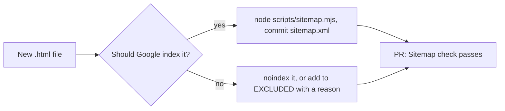

# villasatsheriden.com

The Villas at Sheriden's website (Carey, OH). Plain static HTML served by
Netlify (`publish = "."`), with Netlify Functions in `netlify/functions/` for
the contact form and waitlist. Managed by LaunchEngine.

Canonical host: `https://villasatsheriden.com`. `www` and `http` redirect
there at the Netlify domain level.

## Adding a page

`sitemap.xml` is generated. Never edit it by hand.

1. Add the `.html` file. Its `<link rel="canonical">` may be relative
   (`href="newpage.html"`, like the other pages) or a full URL on
   `https://villasatsheriden.com`; never another host, never `index.html`.
2. Run `node scripts/sitemap.mjs` and commit the updated `sitemap.xml` with the page.
3. If the page must stay out of Google (a thank-you page, a test page), give it
   `<meta name="robots" content="noindex">` (as `privacypolicy.html` and
   `termsandconditions.html` have), or add its path to `EXCLUDED` in
   `scripts/sitemap.mjs` with a one-line reason.

The `Sitemap` check on every pull request fails when a page is in neither the
sitemap nor `EXCLUDED`, when the sitemap lists something that is not a page,
when a canonical points at another host or at `index.html`, or when
`robots.txt` loses its `Sitemap:` line. The error says exactly what to do.

How it works:

- The sitemap URL is the page's canonical, or its file path when it has none.
- `lastmod` is the date of the last git commit that touched that page's file.
  An uncommitted page gets no `lastmod`, never a made-up date.
- On every deploy Netlify runs `node scripts/sitemap.mjs --netlify`, which
  fetches full git history (Netlify clones shallow) and rewrites `sitemap.xml`,
  so the live dates are always current even if the committed copy lags. If
  the script fails, the deploy fails and the current live deploy stays up.
- LaunchEngine's site-monitor resubmits the sitemap to Search Console when it
  changes and alerts Slack if a listed page is not indexed within 7 days.
  It needs the `google-site-verification` tag in `index.html`; keep it.
- The check also fails if `netlify.toml` or `_headers` sends an
  `X-Robots-Tag: noindex` header, since that would hide every page.

## Follow-up

- [ ] Add LaunchEngine's `<meta name="google-site-verification">` tag to the `<head>` of `index.html` (token not issued yet; no shared head template on this site).
